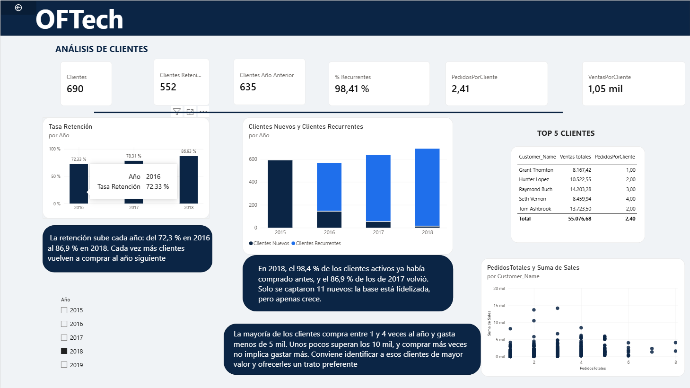
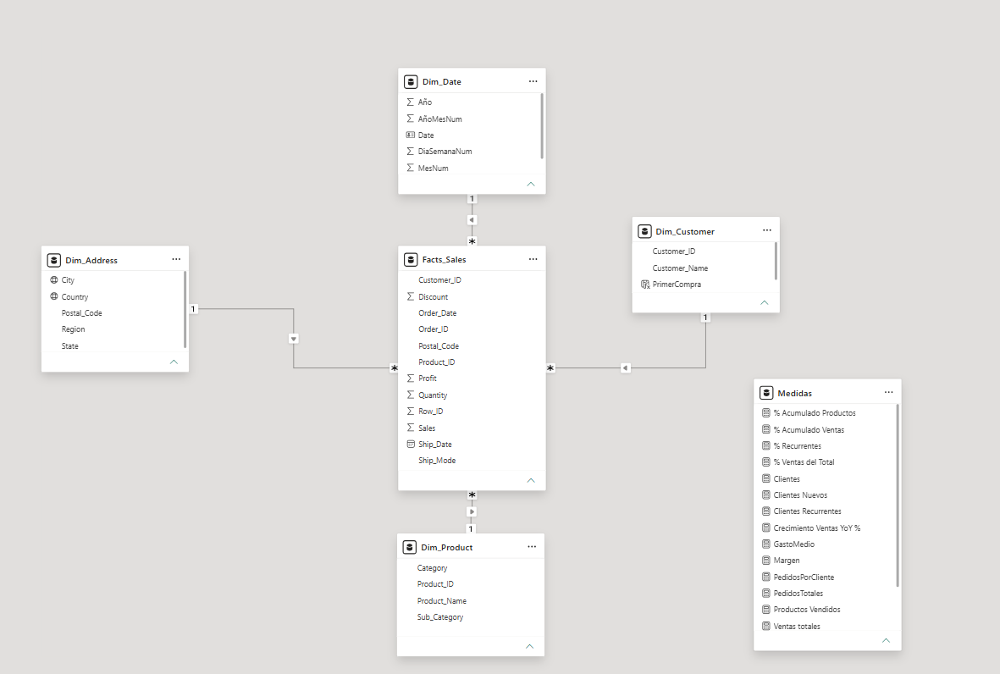

# portfolio
Business Analysis
OFTech es una empresa estadounidense online fundada en 2015 distribuidor de mobiliario, tecnología y material de oficina en Estados Unidos.

> Nota: la empresa es ficticia. Los datos proceden del dataset público
> Superstore (Kaggle).

En este informe se centra en:
-el análisis de ventas interanual: ¿la empresa crece o se estanca? ¿ Cuanto margen y beneficio aporta cada línea?
-rendimiento de los productos: ¿qué lineas son las que más se venden?¿Cuales aportan un mayor beneficio? 
-la fidelidad de los clientes:¿qué porcentaje de clientes son nuevos y recurrenetses?¿ Cuanto duinero gastan en la empresa?

## Demo
### 1. Análisis general de ventas

**Qué muestra:** ventas totales, beneficio, margen, clientes y crecimiento
interanual, junto con la evolución mensual frente al año anterior, el reparto
por categoría y por estado, y la relación entre ventas y beneficio por subcategoría.

**Hallazgos (2018):**
- Las ventas ascienden a 722 mil, un 20,3 % más que en 2017, con un margen del 12,6 %.
- Furniture vende un volumen similar al de Technology, pero con un margen muy
  inferior al global.
- Algunas subcategorías (Bookcases, Supplies y Tables) generan beneficio negativo.

**Recomendación:** revisar precios y descuentos en Furniture y en las
subcategorías con pérdidas.

### 2. Análisis de producto

**Qué muestra:** concentración de ventas por subcategoría (Pareto), estacionalidad
por categoría y dos tablas comparando las subcategorías que más aportan con las que
pierden dinero.

**Hallazgos:**
- Pocas subcategorías concentran más de la mitad de las ventas.
- Bookcases, Supplies y Tables venden 363 mil pero acumulan 22,8 mil de pérdidas
  en el periodo completo.
- Copiers, Phones y Accessories generan 139,7 mil de beneficio.

**Recomendación:** reforzar stock y campañas en las líneas rentables y analizar
el descuento aplicado en las que pierden.

### 3. Análisis de clientes

**Qué muestra:** clientes activos, nuevos frente a recurrentes por año, tasa de
retención, los mayores clientes y la relación entre número de pedidos y ventas.
**Hallazgos:**
- La retención sube del 72,3 % en 2016 al 86,9 % en 2018.
- En 2018, el 98,4 % de los clientes activos (679 de 690) ya había comprado antes;
  solo se captaron 11 nuevos.
- Comprar más veces no implica gastar más: el valor de un cliente depende más del
  importe por pedido que de la frecuencia.

**Recomendación:** mantener la fidelización y reforzar la captación de nuevos
clientes, que casi no crece.

## Datos
- **Fuente:**  [Superstore Dataset (Kaggle)](https://www.kaggle.com/datasets/vivek468/superstore-dataset-final)
  
- **Limpieza:** detecté un error de separador decimal que inflaba `Sales`.
Al final queda una tabla de 9400 filas con 21 columnas.
## Modelado de datos
Modelo en estrella: una tabla de medidas (número medio de clientes, Ventas por clientes,pedidos totales, crecimiento de ventas año tras año...), una tabla de hechos (`Facts_Sales`, una fila por línea
de producto en un pedido) y dimensiones de cliente, producto, ubicación y fecha.

## Hallazgos
“El análisis de [N] pedidos muestra que las ventas [crecen/caen] un [X] % interanual, con [Y] % concentrado en el último trimestre. [Categoría] genera el mayor volumen, pero [subcategoría] opera con margen [bajo/negativo] debido a descuentos elevados. 12 clientes generan el 10 % de las ventas, por lo que recomiendo mejorar planes de fidelizacion. En el 2018 menos del 2% fueron clientes nuevos convendria centarrase en campañas para captar mas clientes. Los productos mas demandados fueron.. que tambien fueron los más rentables.

## Herramientas
Power BI, Power Query, DAX, modelado dimensional.

## Estructura del repositorio
- `data/`: datos de origen
- `report/`: archivo .pbix
- `images/`: capturas
- `docs/`: PDF del informe
